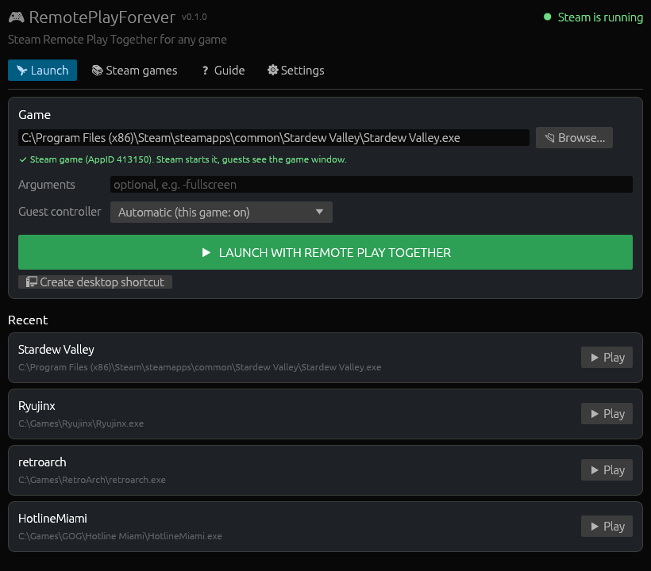
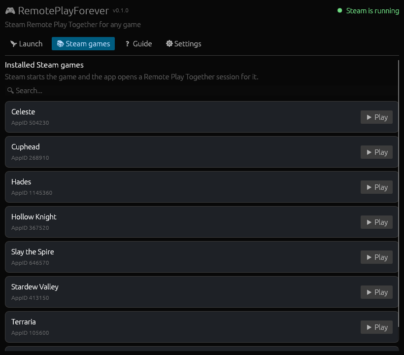
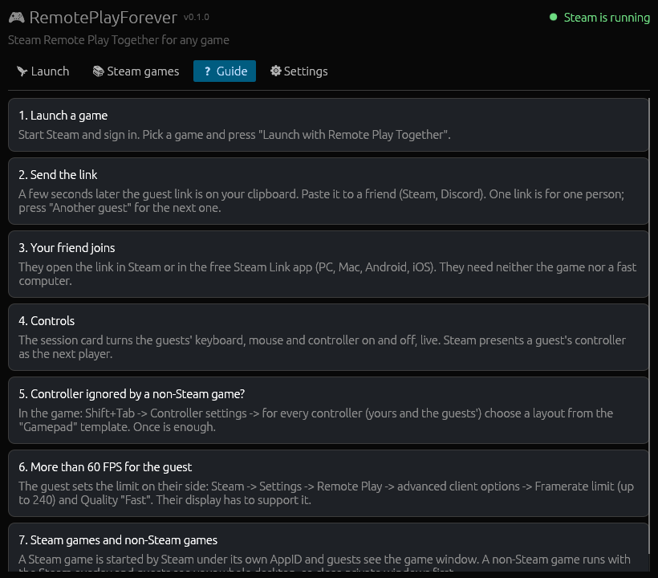
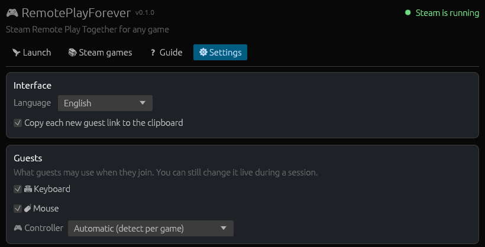

<div align="center">

# RemotePlayForever

**Steam Remote Play Together for any game.**<br>
Emulators, GOG, Epic, non-Steam games and Steam games that never enabled it.

[](https://github.com/KayZedd/remoteplayforever/releases/latest)
[](https://github.com/KayZedd/remoteplayforever/releases)
[](https://github.com/KayZedd/remoteplayforever/actions/workflows/ci.yml)
[](LICENSE)
[](#limitations)

### [⬇ Download the installer](https://github.com/KayZedd/remoteplayforever/releases/latest)

English | [Polski](README.pl.md)



</div>

Pick a game, press launch, send the link. Your friend joins from Steam or the free **Steam Link** app (PC, Mac, Linux, Android, iOS, TV) and needs neither the game nor a fast computer.

- **No donor game.** Nothing to own, nothing to configure in Steam.
- **Nothing is changed in the game's folder.**
- **Guest controllers work** in non-Steam games too, through Steam's own overlay and Steam Input.
- **Built to survive Steam updates.** Steam's internal methods are found by name at runtime, not by hardcoded offsets.
- **One click per extra guest.** Live switches for each guest's keyboard, mouse and controller.
- English and Polish interface.

## Works with

| Source | For example | Guests see |
|---|---|---|
| Emulators | Ryujinx, Yuzu forks, RetroArch, PCSX2, Dolphin, Cemu | Your desktop |
| GOG, Epic, itch.io, standalone `.exe` | anything you can start from an `.exe` | Your desktop |
| Steam games without Remote Play Together | any installed Steam game | The game window |
| Steam games with Remote Play Together | works too, with the extra guest and input controls | The game window |

Anything that starts from an `.exe` can be launched. Titles people actually played are in the [compatibility list](docs/COMPATIBILITY.md). Played something? [Report it](https://github.com/KayZedd/remoteplayforever/issues/new?template=game_report.yml).

## Quick start

1. Start **Steam** and sign in.
2. [Install](https://github.com/KayZedd/remoteplayforever/releases/latest) and run **RemotePlayForever**.
3. On the **Launch** tab pick the game's `.exe` (or pick a title on the **Steam games** tab) and press **Launch with Remote Play Together**.
4. A few seconds later the **guest link** is on your clipboard. Send it to a friend.
5. Close the game or press **End session** to disconnect the guests.

The session card shows the link, an **Another guest** button (one link is for one person) and live switches for the guests' keyboard, mouse and controller.

Language, default guest permissions and clipboard behaviour are on the **Settings** tab.

<details>
<summary><b>More screenshots</b></summary>
<br>

| Steam games | Built-in guide | Settings |
|---|---|---|
|  |  |  |

</details>

## FAQ

**Does my friend need the game?** No. They need a Steam account or the free Steam Link app. The game runs on your PC and is streamed to them.

**Is it safe? Will I get banned?** The app does not read or write game memory and does not touch the game's files. For non-Steam games it loads Steam's own `GameOverlayRenderer64.dll`, the same overlay Steam puts into every game it starts. Games with kernel anti-cheat (EAC, BattlEye, Vanguard) may still object to an unusual launch, so do not use it with competitive online games. No guarantees: it relies on undocumented Steam internals.

**Why does my antivirus complain?** The app attaches to Steam and loads the overlay module into another process, which some heuristic engines flag. Releases after 0.1.0 are built by [GitHub Actions](.github/workflows/release.yml) from the tagged commit and carries a build provenance attestation and SHA-256 checksums, see [Verifying a download](#verifying-a-download).

**The guest's controller does nothing in a non-Steam game.** See [Controller ignored by a non-Steam game?](#controller-ignored-by-a-non-steam-game) below. One-time setup in Shift+Tab.

**Steam Deck / Linux / macOS host?** No. The host must be Windows x64. Guests can use any platform.

**Something broke after a Steam update.** [Open an issue](https://github.com/KayZedd/remoteplayforever/issues/new?template=bug_report.yml) with `%LOCALAPPDATA%\RemotePlayForever\launch.log` attached.

## How it works

The app attaches to the running, signed-in Steam client through `steamclient64.dll` and calls its internal `IClientRemoteClientManager`, the same interface the Steam overlay uses for "Invite to Remote Play Together":

1. `BCreateRemotePlayGroup(AppID)` creates a Remote Play Together group for the game.
2. `BCreateRemotePlayInviteAndSession` creates a guest slot and returns the **invite link**.
3. `SetPerUser{Keyboard,Mouse,Controller}InputEnabled` grants input to guests.
4. `DisbandRemotePlayTogetherGroup` disconnects the guests when the game exits.

Two launch modes, chosen automatically:

| Game | How it starts | Session AppID | Guests see |
|---|---|---|---|
| Installed Steam game | Steam launches it under **its own AppID** (license, DRM and overlay behave as usual) | The game's AppID | The game window |
| Non-Steam game | From its `.exe`, with the **Steam overlay** (Shift+Tab, Steam Input, guest controllers) | `480`, used only as a label; nothing is installed | **Your whole desktop** |

> With a non-Steam game guests see your whole desktop. Close private windows before sending the link.

### The overlay in a non-Steam game

Steam only puts its overlay into games it launches itself, but the overlay library follows child processes on its own. A small windowless launcher (`remoteplayforever.exe --overlay-launch`, [src/overlay.rs](src/overlay.rs)) loads Steam's own `GameOverlayRenderer64.dll`, sets `SteamGameId` and `SteamOverlayGameId` to `480` and only then starts the game. Steam registers the game's process and window under that id, which is what makes Steam Input and guest controllers work.

### Surviving Steam updates

The interface is undocumented and the order of its methods shifts between client builds, so the app **never calls by index**. Every client method is an IPC stub that references its own name as a string; at startup the app builds a `name -> index` map from them (`scan_vtable_names` in [src/rpt.rs](src/rpt.rs)). If a method it needs is gone, the session reports an error instead of guessing.

The session runs in a separate helper process (`remoteplayforever.exe --host-session`), so a bad call into Steam's internals cannot take the window down.

## Guests

- They open the link in Steam or in the **Steam Link** app (Windows, macOS, Linux, Android, iOS, Android TV).
- They get the keyboard and mouse, and a controller when the game supports one (setting **Guest controller**: automatic / on / off).
- The stream's frame limit is set by the guest: Steam -> Settings -> Remote Play -> advanced client options -> **Framerate limit** (up to 240 FPS). The host cannot raise it.

### Controller ignored by a non-Steam game?

A non-Steam game is registered under id `480` (Spacewar), and Steam Input has its own layouts for that id: Spacewar's action set for Xbox controllers, an empty one for DualSense. Neither behaves like a plain gamepad, so the game sees no input. Once:

1. In the game press **Shift+Tab** and open **Controller settings**.
2. For **every** controller tab (yours and each guest's) choose a layout from the **Gamepad** template.

Steam remembers the choice per controller type. Guest controllers appear in that list only after the guest has joined.

## Command line

```bash
# Open the window and launch a game with a session right away
remoteplayforever.exe --run "C:\Games\MyGame\game.exe"

# Same in the console, no window (blocks until the game closes, prints the link)
remoteplayforever.exe --cli --run "C:\Games\MyGame\game.exe"

# Extra arguments for the game
remoteplayforever.exe --run "C:\Emulators\yuzu.exe" --args "-f" "-g" "C:\Roms\game.nsp"

# Console menu
remoteplayforever.exe --cli

# List installed Steam games
remoteplayforever.exe --list-games
```

## Verifying a download

Releases after 0.1.0 are built by GitHub Actions and every `.exe` carries a build provenance attestation. Check it with the [GitHub CLI](https://cli.github.com/):

```bash
gh attestation verify RemotePlayForever-Setup-X.Y.Z.exe --repo KayZedd/remoteplayforever
```

Or compare the SHA-256 against `SHA256SUMS.txt` from the same release:

```powershell
Get-FileHash .\RemotePlayForever-Setup-X.Y.Z.exe -Algorithm SHA256
```

## Limitations

- Windows x64 with a running, signed-in Steam client.
- A non-Steam game is shared as the **whole desktop**, not a single window.
- For a Steam game the app starts the game's default launch option. Picking another `.exe` from its folder (a mod loader, say) still starts the game through Steam.
- It relies on Steam internals. A large client update may need a new release. Each session is logged to `%LOCALAPPDATA%\RemotePlayForever\launch.log`.
- Antivirus false positives are possible, see the [FAQ](#faq).
- Not affiliated with Valve. Use at your own risk.

### For maintainers: when Valve changes a signature

Method names resolve on their own, but **arguments** can change (`BCreateRemotePlayGroup` and `GetLocalRemotePlayTogetherGroupID` started taking the AppID at some point). Every client method is an IPC stub that serializes its arguments in order, so a disassembly shows the size of each argument and of the return value. The real call order is also visible in Steam's own interface code, `Steam\steamui\*.js` (`SteamClient.RemotePlay.*`).

## Building

Rust 1.85+ (edition 2024):

```bash
git clone https://github.com/KayZedd/remoteplayforever.git
cd remoteplayforever
cargo test
cargo build --release
```

The binary is `target\release\remoteplayforever.exe`. For an installer (Inno Setup 6): `./build_installer.ps1`.

Layout:

| File | Role |
|---|---|
| [src/rpt.rs](src/rpt.rs) | Session host: Steam client attachment, group, invites, guest input |
| [src/overlay.rs](src/overlay.rs) | Launcher that starts a non-Steam game with the Steam overlay |
| [src/session.rs](src/session.rs) | Line protocol between the app and the session host |
| [src/runner.rs](src/runner.rs) | Launch plan and the game + session lifecycle |
| [src/gui.rs](src/gui.rs), [src/ui.rs](src/ui.rs) | Window and console interfaces |
| [src/i18n.rs](src/i18n.rs) | Interface language |

### CI and releases

- [`.github/workflows/ci.yml`](.github/workflows/ci.yml): every push to `master` and every PR runs `cargo fmt --check`, `cargo clippy -D warnings`, `cargo test` and a release build on `windows-latest`. The `.exe` is attached to the run as an artifact.
- [`.github/workflows/release.yml`](.github/workflows/release.yml): pushing a tag `vX.Y.Z` builds the installer and publishes a GitHub release with the installer, the bare `.exe` and `SHA256SUMS.txt`, plus a build provenance attestation for each `.exe`. The tag must match `version` in `Cargo.toml` and `MyAppVersion` in `installer/installer.iss`, otherwise the job fails.

```bash
git tag vX.Y.Z && git push origin vX.Y.Z
```

### Screenshots and social preview

- `docs/img/*.png` are taken from the real app under wine on Linux with a fake Steam library: `docs/screenshots/capture.sh` (see the comments at its top).
- `docs/img/social-preview.png` (upload it in **Settings -> General -> Social preview**) is rendered from [`docs/social-preview.html`](docs/social-preview.html) by `docs/make-social-preview.sh`.

## Credits

- [RemotePlayWhatever](https://github.com/m4dEngi/RemotePlayWhatever) by m4dEngi: the original technique.
- [RemotePlayForge](https://github.com/okabeeer/RemotePlayForge) by okabeeer (MIT): resolving methods by name and the group -> invite -> input sequence.

## Support the project

If it saved you buying a second copy of a game, a ⭐ helps other people find it. Bug reports and [compatibility reports](https://github.com/KayZedd/remoteplayforever/issues/new?template=game_report.yml) help even more.

## License

[MIT](LICENSE). "Steam" and "Remote Play Together" are trademarks of Valve Corporation.
