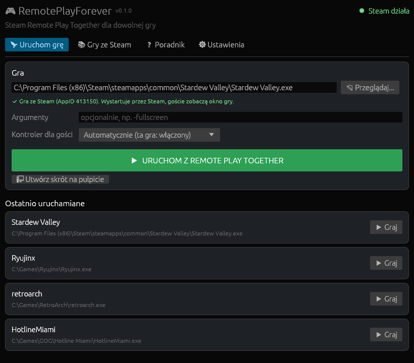
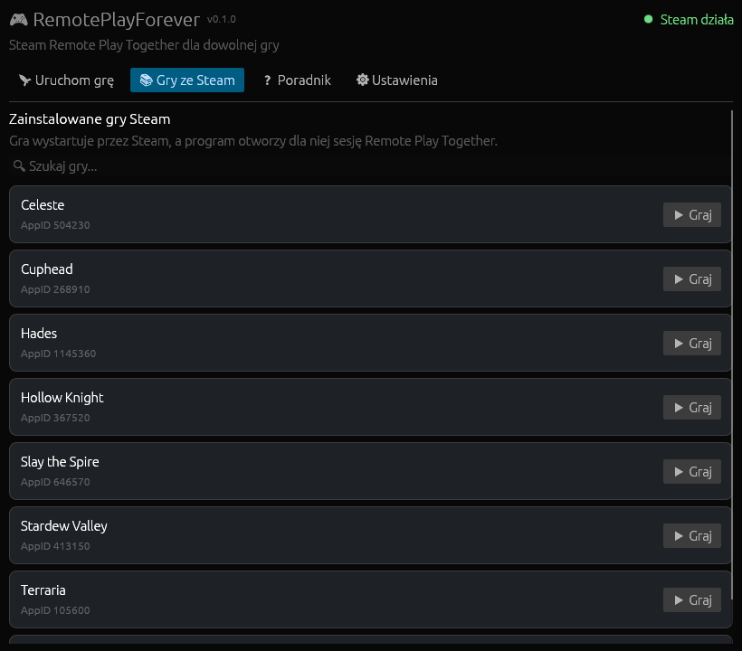
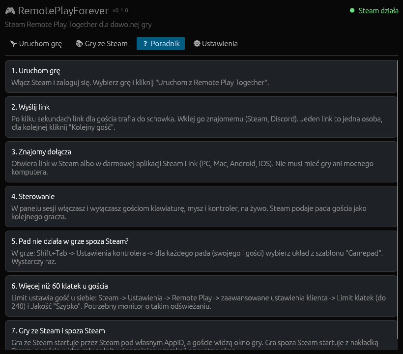
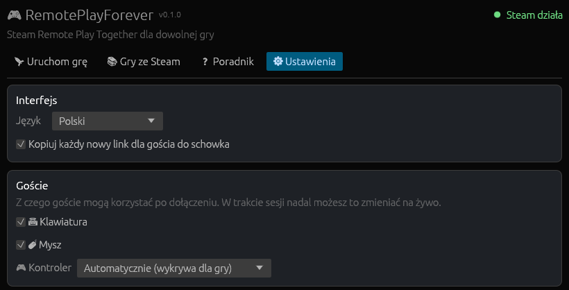

<div align="center">

# RemotePlayForever

**Steam Remote Play Together dla dowolnej gry.**<br>
Emulatory, GOG, Epic, gry spoza Steama i gry ze Steama, które nigdy tego nie włączyły.

[](https://github.com/KayZedd/remoteplayforever/releases/latest)
[](https://github.com/KayZedd/remoteplayforever/releases)
[](https://github.com/KayZedd/remoteplayforever/actions/workflows/ci.yml)
[](LICENSE)
[](#ograniczenia)

### [⬇ Pobierz instalator](https://github.com/KayZedd/remoteplayforever/releases/latest)

[English](README.md) | Polski



</div>

Wybierz grę, kliknij uruchom, wyślij link. Znajomy dołącza ze Steama albo z darmowej aplikacji **Steam Link** (PC, Mac, Linux, Android, iOS, TV) i nie potrzebuje ani gry, ani mocnego komputera.

- **Bez gry-dawcy.** Nic nie trzeba mieć ani ustawiać w Steamie.
- **Nic nie jest zmieniane w folderze gry.**
- **Pady gości działają** także w grach spoza Steama, przez overlay Steama i Steam Input.
- **Odporne na aktualizacje Steama.** Wewnętrzne metody Steama są wyszukiwane po nazwie w czasie działania, nie po zaszytych offsetach.
- **Jedno kliknięcie na każdego kolejnego gościa.** Przełączniki klawiatury, myszy i pada dla gości na żywo.
- Interfejs po polsku i po angielsku.

## Z czym działa

| Źródło | Na przykład | Goście widzą |
|---|---|---|
| Emulatory | Ryujinx, forki Yuzu, RetroArch, PCSX2, Dolphin, Cemu | Twój pulpit |
| GOG, Epic, itch.io, dowolny `.exe` | wszystko, co startuje z `.exe` | Twój pulpit |
| Gry ze Steama bez Remote Play Together | dowolna zainstalowana gra ze Steama | Okno gry |
| Gry ze Steama z Remote Play Together | też działa, z kolejnymi gośćmi i kontrolą wejścia | Okno gry |

Uruchomić można wszystko, co startuje z `.exe`. Gry, w które ktoś faktycznie grał, są na [liście zgodności](docs/COMPATIBILITY.md). Grałeś w coś? [Zgłoś to](https://github.com/KayZedd/remoteplayforever/issues/new?template=game_report.yml).

## Szybki start

1. Uruchom **Steam** i zaloguj się.
2. [Zainstaluj](https://github.com/KayZedd/remoteplayforever/releases/latest) i uruchom **RemotePlayForever**.
3. Na zakładce **Uruchom grę** wybierz `.exe` gry (albo tytuł na zakładce **Gry ze Steam**) i kliknij **Uruchom z Remote Play Together**.
4. Po kilku sekundach **link dla gościa** jest w schowku. Wyślij go znajomemu.
5. Zamknij grę albo kliknij **Zakończ sesję**, żeby rozłączyć gości.

Panel sesji pokazuje link, przycisk **Kolejny gość** (jeden link to jedna osoba) i przełączniki klawiatury, myszy i pada gości na żywo.

Język, domyślne uprawnienia gości i kopiowanie linku do schowka są na zakładce **Ustawienia**.

<details>
<summary><b>Więcej screenów</b></summary>
<br>

| Gry ze Steam | Wbudowany poradnik | Ustawienia |
|---|---|---|
|  |  |  |

</details>

## FAQ

**Czy znajomy musi mieć grę?** Nie. Wystarczy konto Steam albo darmowa aplikacja Steam Link. Gra działa na Twoim PC i jest do niego streamowana.

**Czy to bezpieczne? Dostanę bana?** Aplikacja nie czyta ani nie zapisuje pamięci gry i nie dotyka jej plików. Przy grach spoza Steama ładuje własny `GameOverlayRenderer64.dll` Steama, ten sam overlay, który Steam wkłada do każdej uruchamianej gry. Gry z anty-cheatem na poziomie jądra (EAC, BattlEye, Vanguard) mogą mimo to nie zaakceptować nietypowego uruchomienia, więc nie używaj tego z rywalizacyjnymi grami online. Bez gwarancji: aplikacja korzysta z nieudokumentowanych mechanizmów Steama.

**Czemu antywirus krzyczy?** Aplikacja podpina się pod Steama i ładuje moduł overlayu do innego procesu, co niektóre silniki heurystyczne oznaczają. Wydania po 0.1.0 są budowane przez [GitHub Actions](.github/workflows/release.yml) z otagowanego commita i ma atestację pochodzenia buildu oraz sumy SHA-256, zobacz [Weryfikacja pobranego pliku](#weryfikacja-pobranego-pliku).

**Pad gościa nic nie robi w grze spoza Steama.** Zobacz [Gra spoza Steama ignoruje pada?](#gra-spoza-steama-ignoruje-pada) niżej. Jednorazowe ustawienie w Shift+Tab.

**Host na Steam Decku / Linuksie / macOS?** Nie. Host musi być na Windows x64. Goście mogą być na dowolnej platformie.

**Coś się zepsuło po aktualizacji Steama.** [Zgłoś problem](https://github.com/KayZedd/remoteplayforever/issues/new?template=bug_report.yml) i dołącz `%LOCALAPPDATA%\RemotePlayForever\launch.log`.

## Jak to działa

Aplikacja podłącza się do uruchomionego, zalogowanego klienta Steam przez `steamclient64.dll` i wywołuje jego wewnętrzny `IClientRemoteClientManager`, ten sam interfejs, którego overlay Steama używa do "Zaproś do Remote Play Together":

1. `BCreateRemotePlayGroup(AppID)` tworzy grupę Remote Play Together dla gry.
2. `BCreateRemotePlayInviteAndSession` tworzy miejsce dla gościa i zwraca **link z zaproszeniem**.
3. `SetPerUser{Keyboard,Mouse,Controller}InputEnabled` daje gościom sterowanie.
4. `DisbandRemotePlayTogetherGroup` rozłącza gości po zamknięciu gry.

Dwa tryby uruchamiania, wybierane automatycznie:

| Gra | Jak startuje | AppID sesji | Goście widzą |
|---|---|---|---|
| Zainstalowana gra ze Steama | Steam uruchamia ją pod **jej własnym AppID** (licencja, DRM i overlay działają normalnie) | AppID gry | Okno gry |
| Gra spoza Steama | Z jej `.exe`, z **overlayem Steama** (Shift+Tab, Steam Input, pady gości) | `480`, tylko jako etykieta; nic nie jest instalowane | **Cały Twój pulpit** |

> Przy grze spoza Steama goście widzą cały pulpit. Zamknij prywatne okna przed wysłaniem linku.

Szczegóły techniczne (overlay w grach spoza Steama, odporność na aktualizacje, proces pomocniczy sesji) są w [angielskim README](README.md#how-it-works).

## Goście

- Otwierają link w Steamie albo w aplikacji **Steam Link** (Windows, macOS, Linux, Android, iOS, Android TV).
- Dostają klawiaturę i mysz, a pada, gdy gra go obsługuje (ustawienie **Kontroler dla gości**: automatycznie / włączony / wyłączony).
- Limit klatek streamu ustawia gość: Steam -> Ustawienia -> Remote Play -> zaawansowane ustawienia klienta -> **Limit klatek** (do 240 FPS). Host nie może go podnieść.

### Gra spoza Steama ignoruje pada?

Gra spoza Steama jest rejestrowana pod id `480` (Spacewar), a Steam Input ma dla tego id własne układy: zestaw akcji Spacewar dla padów Xbox i pusty dla DualSense. Żaden nie działa jak zwykły gamepad, więc gra nie widzi wejścia. Jednorazowo:

1. W grze wciśnij **Shift+Tab** i otwórz **Ustawienia kontrolera**.
2. Dla **każdej** zakładki kontrolera (Twojej i każdego gościa) wybierz układ z szablonu **Gamepad**.

Steam zapamiętuje wybór dla danego typu pada. Pady gości pojawiają się na tej liście dopiero po dołączeniu gościa.

## Wiersz poleceń

```bash
# Otwórz okno i od razu uruchom grę z sesją
remoteplayforever.exe --run "C:\Games\MyGame\game.exe"

# To samo w konsoli, bez okna (czeka na zamknięcie gry, wypisuje link)
remoteplayforever.exe --cli --run "C:\Games\MyGame\game.exe"

# Dodatkowe argumenty dla gry
remoteplayforever.exe --run "C:\Emulators\yuzu.exe" --args "-f" "-g" "C:\Roms\game.nsp"

# Menu w konsoli
remoteplayforever.exe --cli

# Lista zainstalowanych gier ze Steama
remoteplayforever.exe --list-games
```

## Weryfikacja pobranego pliku

Wydania po 0.1.0 są budowane przez GitHub Actions i każdy `.exe` ma atestację pochodzenia buildu. Sprawdzisz ją przez [GitHub CLI](https://cli.github.com/):

```bash
gh attestation verify RemotePlayForever-Setup-X.Y.Z.exe --repo KayZedd/remoteplayforever
```

Albo porównaj SHA-256 z `SHA256SUMS.txt` z tego samego wydania:

```powershell
Get-FileHash .\RemotePlayForever-Setup-X.Y.Z.exe -Algorithm SHA256
```

## Ograniczenia

- Windows x64 z uruchomionym, zalogowanym klientem Steam.
- Gra spoza Steama jest udostępniana jako **cały pulpit**, nie pojedyncze okno.
- Gra ze Steama startuje z domyślną opcją uruchamiania. Wybranie innego `.exe` z jej folderu (np. loadera modów) i tak uruchamia grę przez Steam.
- Aplikacja korzysta z wewnętrznych mechanizmów Steama. Duża aktualizacja klienta może wymagać nowego wydania. Każda sesja jest logowana do `%LOCALAPPDATA%\RemotePlayForever\launch.log`.
- Możliwe fałszywe alarmy antywirusów, zobacz [FAQ](#faq).
- Projekt niezwiązany z Valve. Używasz na własne ryzyko.

## Budowanie

Instrukcje budowania, CI i wydań są w [angielskim README](README.md#building).

## Podziękowania

- [RemotePlayWhatever](https://github.com/m4dEngi/RemotePlayWhatever) autorstwa m4dEngi: oryginalna technika.
- [RemotePlayForge](https://github.com/okabeeer/RemotePlayForge) autorstwa okabeeer (MIT): wyszukiwanie metod po nazwie i sekwencja grupa -> zaproszenie -> wejście.

## Wesprzyj projekt

Jeśli oszczędziło Ci to kupowania drugiej kopii gry, ⭐ pomaga innym go znaleźć. Zgłoszenia błędów i [raporty zgodności gier](https://github.com/KayZedd/remoteplayforever/issues/new?template=game_report.yml) pomagają jeszcze bardziej.

## Licencja

[MIT](LICENSE). "Steam" i "Remote Play Together" są znakami towarowymi Valve Corporation.
